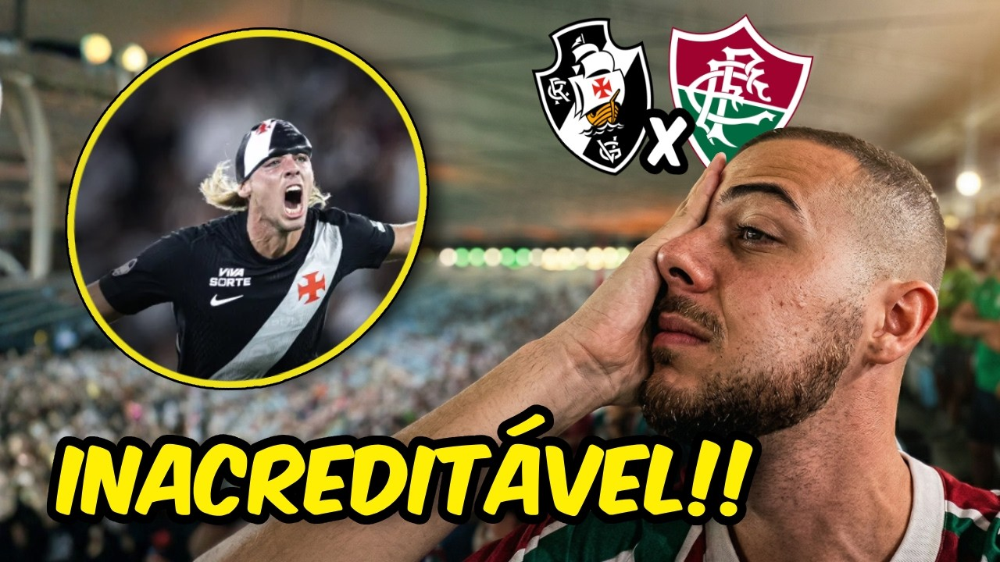

# 🎬 Portfólio para Editor de Vídeo

Uma página web de portfólio simples e objetiva, feita para editores de vídeo mostrarem seu trabalho. Feita apenas com **HTML, CSS e JavaScript puro** — sem frameworks, sem instalação de dependências e sem etapa de build. É só abrir e usar.

## ✨ O que a página tem

- **Tela de loading** com um cubo 3D girando, que "sobe" e revela o site.
- **Perfil**: foto, nome e uma breve descrição.
- **Portfólio** dividido em três categorias:
  - **Long Videos** — 4 vídeos horizontais (16:9) do YouTube.
  - **Shorts** — 4 vídeos verticais (9:16) do YouTube.
  - **Thumbnails** — 4 imagens.
- **Vídeos com carregamento sob demanda**: a página mostra só a capa com um botão de play. O player do YouTube só é carregado quando o visitante clica, o que deixa o site mais leve e rápido.
- **Selo "Commissions: ON"** indicando que você está aceitando trabalhos.
- **Seção de contato** com ícones para Instagram, X (Twitter), LinkedIn e e-mail.
- **Animações de entrada** conforme o visitante rola a página.
- **Responsivo**: layout e imagem de fundo próprios para celular.

## 📁 Estrutura do projeto

```
editor/
├── index.html      → Conteúdo da página (textos, vídeos, links)
├── style.css       → Aparência (cores, fontes, layout, animações)
├── script.js       → Comportamento (loading, animações, player do YouTube)
├── favicon.ico     → Ícone da aba do navegador
├── fonts/          → Fontes usadas no site
└── media/          → Imagens: perfil, fundos, capas de vídeos e thumbnails
```

## 🚀 Como usar

1. **Baixe o projeto**: clique em **Code → Download ZIP** aqui no GitHub e extraia a pasta (ou use `git clone`).
2. **Abra o `index.html`** no navegador.

> **⚠️ Dica importante:** alguns navegadores bloqueiam ou dão erro nos vídeos do YouTube quando a página é aberta direto do arquivo (`file://`). Se os vídeos não carregarem, rode um servidor local:
> - No **VS Code**, instale a extensão **Live Server**, clique com o botão direito no `index.html` e escolha **Open with Live Server**; ou
> - Com Python instalado, abra o terminal na pasta do projeto e rode `python -m http.server 8000`, depois acesse `http://localhost:8000`.

## 🛠️ Como personalizar

Toda a personalização acontece em três lugares: o `index.html` (conteúdo), a pasta `media/` (imagens) e o `style.css` (visual). Você não precisa mexer no `script.js` para o uso normal.

### 1. Perfil (foto, nome e descrição)

No `index.html`, procure a seção `<!-- SEÇÃO: PERFIL -->`:

```html

<h1 class="nome">Seu Nome</h1>
<p class="descricao">
    Sua descrição aqui,<br>
    use &lt;br&gt; para quebrar a linha.
</p>
```

- Para trocar a foto, substitua o arquivo `media/perfil.jpg` por uma imagem sua **com o mesmo nome**, ou altere o `src` para o novo nome.
- Use uma foto **quadrada** para o melhor resultado (ela é exibida dentro de um círculo).

### 2. Vídeos longos e Shorts

Os vídeos vêm do **YouTube**. Cada vídeo usa o **ID** dele, que é o código no final do link:

```
https://www.youtube.com/watch?v=SZKalHAfhU4
                                └── este é o ID
```

Para Shorts, o link é `https://www.youtube.com/shorts/BBjZoYEQxRo` — o ID é o código depois de `/shorts/`.

No `index.html`, cada vídeo é um bloco assim:

```html
<div class="video-card">
    <button type="button" class="video-overlay" data-video-id="SZKalHAfhU4" aria-label="Reproduzir vídeo longo 1">
        
        <span class="play-btn-vazado" aria-hidden="true"></span>
    </button>
    <div class="iframe-container"></div>
</div>
```

Para trocar um vídeo, mude **duas coisas**:

1. O ID no atributo `data-video-id="..."`.
2. A imagem de capa (`src="media/longo1.jpg"`) — substitua o arquivo em `media/` ou aponte para outro.

O `script.js` cuida do resto sozinho: qualquer botão com `data-video-id` abre o player do YouTube no clique.

Os Shorts funcionam do mesmo jeito (blocos `short-card`, com capas `short1` a `short4`).

**Adicionar mais vídeos:** copie um bloco inteiro (`video-card` ou `short-card`) e cole logo abaixo, dentro do mesmo `grid`. Longos ficam em 2 colunas e Shorts em 4 colunas (1 coluna no celular).

**Remover um vídeo:** apague o bloco correspondente.

> 💡 Sobre as capas: você pode usar a própria thumbnail do YouTube ou uma imagem criada por você. Prefira imagens 16:9 para os longos e 9:16 para os Shorts — elas são cortadas automaticamente para preencher o card.

### 3. Thumbnails

Na seção `<!-- THUMBNAILS -->`, cada thumbnail é só uma imagem:

```html
<div class="thumb-card"></div>
```

Substitua os arquivos `thumb1.png` a `thumb4.png` em `media/` pelos seus, ou copie/apague linhas para ter mais ou menos thumbnails.

### 4. Contato e redes sociais

Na seção `<!-- SEÇÃO: CONTATO -->`, altere os links nos ícones:

```html
<a href="https://www.instagram.com/SEU_USUARIO" target="_blank" aria-label="Instagram">
<a href="https://x.com/SEU_USUARIO" target="_blank" aria-label="X">
<a href="https://www.linkedin.com/in/SEU_PERFIL/" target="_blank" aria-label="LinkedIn">
<a href="mailto:seuemail@exemplo.com" target="_blank" aria-label="Email">
```

Para remover uma rede, apague o bloco `<a>...</a>` dela inteiro (incluindo o `<svg>`).

### 5. Selo "Commissions"

Para indicar que você **não** está aceitando trabalhos, altere o texto `COMMISSIONS: ON` para `COMMISSIONS: OFF` no `index.html`. Se quiser, mude também a cor da bolinha no `style.css`, na regra `.dot` (o verde é `#27ae60`).

### 6. Textos, título da aba e rodapé

No `index.html`:

- **Título da aba do navegador:** a tag `<title>Portfólio de Edição</title>` no topo.
- **Títulos das seções e chamada de contato:** `PORTFOLIO`, `LONG VIDEOS`, `SHORTS`, `THUMBNAILS`, `LET'S WORK TOGETHER!` etc. — é só editar o texto.
- **Rodapé:** no final do arquivo, ajuste o copyright e **remova ou troque a linha `A FALL Studios® Creation`**, que é um crédito do autor original.

### 7. Cores

No topo do `style.css`, as cores principais ficam em variáveis:

```css
:root {
    --bg-color: #050505;    /* fundo escuro (e da tela de loading) */
    --text-color: #ffffff;  /* cor dos textos */
    --text-muted: #c4c4c4;  /* textos secundários */
    --accent-color: #ffffff;/* bordas e detalhes */
}
```

Mudando esses valores, o site inteiro acompanha.

### 8. Imagem de fundo

- **Computador:** substitua `media/bg.jpeg`.
- **Celular:** substitua `media/bg-mobile.jpeg` (usada em telas de até 768px).

Para deixar o fundo mais escuro ou mais claro, ajuste o valor de opacidade no `style.css`, na regra `.bg-fixed::after`:

```css
background-color: rgba(0, 0, 0, 0.4); /* 0.6 = mais escuro | 0.2 = mais claro */
```

### 9. Fontes

As fontes ficam na pasta `fonts/` e são carregadas pelas regras `@font-face` no início do `style.css`. A fonte usada em todo o site é a **Providence**. As fontes `ACRealAdult` e `Network` estão declaradas, mas não são usadas no momento.

Para trocar, coloque sua fonte (`.ttf`) em `fonts/`, declare-a com `@font-face` e altere o `font-family` da regra `body`:

```css
body {
    font-family: 'SuaFonte', sans-serif;
}
```

### 10. Tempo da tela de loading

No topo do `script.js`, a constante `PRELOADER_DELAY` (em milissegundos) define por quanto tempo o cubo gira antes da página aparecer:

```js
const PRELOADER_DELAY = 1500;
```

Diminua para uma entrada mais rápida ou aumente para uma abertura mais longa. Para remover a tela de loading, apague o bloco `<div id="preloader">` do `index.html`.

## 🌐 Como publicar o seu site (GitHub Pages)

Depois de personalizar, você pode colocar a página no ar gratuitamente:

1. Envie os arquivos do projeto para um repositório seu no GitHub (com o `index.html` na raiz).
2. No repositório, vá em **Settings → Pages**.
3. Em **Source**, escolha **Deploy from a branch**, selecione a branch `main` e a pasta `/ (root)`, e clique em **Save**.
4. Aguarde alguns minutos: seu site ficará disponível em `https://seu-usuario.github.io/nome-do-repositorio/`.

Outras opções gratuitas que funcionam do mesmo jeito para sites estáticos: **Netlify**, **Vercel** e **Cloudflare Pages**.

## ⚠️ Antes de publicar como seu

Este projeto contém o conteúdo pessoal do autor. Ao usar como base, **troque tudo o que for pessoal**:

- Nome, descrição, foto de perfil e links de contato (Instagram, X, LinkedIn e e-mail);
- Os vídeos do YouTube e suas capas, e as thumbnails;
- O texto de copyright e o crédito no rodapé;
- As imagens de fundo, se não forem suas.

As **fontes** em `fonts/` podem ter licenças próprias (algumas são versões gratuitas com uso restrito). Confira a licença de cada uma antes de usar em um projeto comercial.

## 🧰 Tecnologias

- HTML5
- CSS3 (Grid, Flexbox, animações e variáveis CSS)
- JavaScript (Intersection Observer para as animações de rolagem)
- YouTube Embed (player carregado apenas no clique)

---

## Connect With Me

<p align="left">
  <a href="https://pedrosilva.space" target="_blank">
    
  </a>
  <a href="https://www.linkedin.com/in/pedro-lucas-silva-6b1678358/" target="_blank">
    
  </a>
  <a href="https://x.com/pfiuzzzz" target="_blank">
    
  </a>
  <a href="https://www.instagram.com/pfiuz" target="_blank">
    
  </a>
  <a href="mailto:contato@upedrooo.dev">
    
  </a>
</p>
